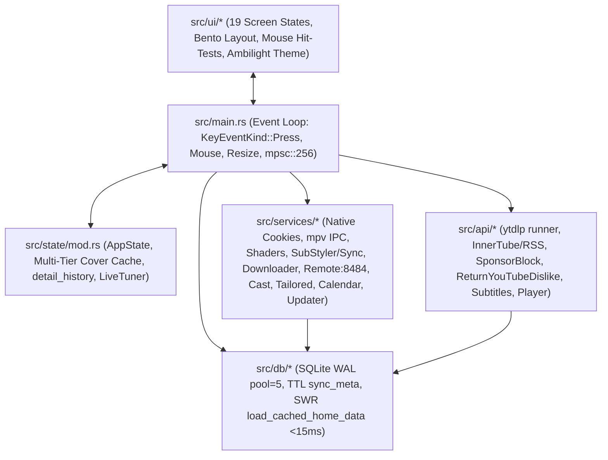

# YouTube Zen TUI -> Solus v1.0.7 Parity Master Plan

> **Goal:** Upgrade [`youtube-zen-tui`](/Users/abdullahbinmadhi/Projects/youtube) from a 2-file `v0.1.0`
> prototype into a production-grade, cross-platform terminal theatre, discovery crucible, and
> companion ecosystem matching [**Solus v1.0.7**](/Users/abdullahbinmadhi/Projects/anime) in speed
> (`<15ms` cold boot via SQLite SWR), visual polish, non-blocking IPC playback, intelligence
> dashboards, and automated test rigor.

---

## 1. Executive Summary & Codebase Baseline

| Dimension | `youtube` (`youtube-zen-tui` v0.1.0) | `solus` (`solus` v1.0.7) |
| :--- | :--- | :--- |
| **Crate / Binary** | `youtube-zen-tui` v0.1.0 (`youtube-tui`) | `solus` v1.0.7 (`solus`, evolved from `ani-tui`) |
| **Rust Source Scale** | 2 files (`src/main.rs` 2,160 LOC + `src/theme.rs` 93 LOC = **2,253 LOC**) | 53 files under `src/` (**43,213 LOC**) + `build.rs` + `migrations/001_initial.sql` |
| **Automated Tests** | **0** test functions in `src/` | **255** `fn test_` unit & Ratatui `TestBackend` tests *(observed via `rg`)* |
| **Startup Path** | Cold `yt-dlp --flat-playlist` spawn per launch (multi-second blank wait) | SQLite WAL SWR (`load_cached_home_data` `<15ms`) + async `sync_all` (`sync_meta` TTLs) |
| **Config & Auth** | Hardcoded `/Users/abdullahbinmadhi/.config/yt-dlp/cookies.txt` (`L27`) & `/opt/homebrew/bin/sync-youtube-cookies` (`L339`) | `directories`-backed XDG `config.toml` + `auth.json` across macOS, Linux & Windows (`src/config.rs`) |
| **Playback Engine** | Blocking foreground `mpv` (`LeaveAlternateScreen` + `cmd.status()`, `L1905-1925`) | Detached `player::spawn_async` (`mpv`/`iina`/`vlc`) + Unix socket / Named Pipe JSON-RPC monitor (`src/services/ipc.rs`) |
| **Auto-Skip & Sync** | None | AniSkip OP/ED auto-seek + 85% auto-scrobble + second-accurate resume (`playback_progress`) |
| **Image Pipeline** | Upscale `<1280px -> 1280px`, magic `0.282` row ratio, no occlusion guard | `scale_to_frame_cover` (`cols*font_w x rows*font_h`), atomic Kitty IDs `>= 100_000`, `HalfblockCover`, 12-permit preloader, `active_modal_rect` guard |
| **Input & Loop** | Unfiltered `Event::Key` (`L506`), keystroke-spawned search (`L622, 647`), no mouse | `KeyEventKind::Press` guard, `BeginSynchronizedUpdate`/`EndSynchronizedUpdate`, full `Event::Mouse` hit-testing, `SkimMatcherV2` Hub |
| **Intelligence & Ops** | None | Braille Analytics, Tailored Wizard + Live Vibe Tuner, Calendar, LAN Remote (`8484`+QR), AirPlay/DLNA Cast, Offline Vault, Doctor (`!`), Updater (`U`) |
| **Packaging & CI** | Local `cargo` build only | 4-target GitHub Actions release matrix + Homebrew formula (`Formula/solus.rb`) |

---

## 2. Diagnosed Bottlenecks in Current `youtube/src/main.rs`

Inspection of `/Users/abdullahbinmadhi/Projects/youtube/src/main.rs` (2,160 lines) reveals eight
concrete architectural bottlenecks blocking Solus-grade responsiveness and portability:

1. **Hardcoded macOS Paths & External Python Cookie Script (`src/main.rs:27`, `src/main.rs:339`)**
   - `const COOKIES_PATH: &str = "/Users/abdullahbinmadhi/.config/yt-dlp/cookies.txt";` is
     hardcoded to a single macOS user account.
   - Startup shells out to `/opt/homebrew/bin/sync-youtube-cookies`, a Python 3 script reading only
     Zen Browser's `~/Library/Application Support/zen/Profiles/*/cookies.sqlite` (`+ -wal`). It
     breaks on Linux/Windows and for Firefox, Chromium/Chrome, or Brave users.

2. **Blocking Foreground Playback (`launch_video`, `src/main.rs:1905-1925`)**
   - Selecting a video calls `LeaveAlternateScreen`, runs `mpv` synchronously on the UI thread via
     `cmd.status()`, and freezes the terminal until the player exits (`IINA` and `Browser` spawn
     via macOS `open` without status tracking).
   - No `mpv` IPC socket is attached, making live progress bars, timestamp resume, 85% auto-watch,
     SponsorBlock segment skipping, and mobile remote control impossible.

3. **Un-Debounced Per-Keystroke `yt-dlp` Process Spawning (`src/main.rs:622`, `src/main.rs:647`)**
   - In `InputMode::Editing`, every keystroke or backspace immediately spawns a fresh
     `yt-dlp ytsearch15:...` child process with no timer debounce, generation/sequence token, or
     cancellation of stale in-flight queries.

4. **Zero Local Persistence / Cold-Boot Latency**
   - No SQLite database or TTL metadata exists. Every launch starts empty until `yt-dlp` finishes
     scraping JSON over the network; channel metadata, watch progress, Watch Later items, and
     decoded thumbnails vanish when quitting.

5. **Terminal Input & Render Tear Defects (`src/main.rs:506`)**
   - `if let Event::Key(key) = event::read()?` omits `key.kind == KeyEventKind::Press`, causing
     double triggers on Windows/Crossterm terminals that emit `Press` and `Release` events.
   - `Event::Mouse` (wheel scroll, tab/pill clicks, card clicks, right-click back) and
     `Event::Resize` are ignored; rendering lacks `BeginSynchronizedUpdate`/`EndSynchronizedUpdate`.

6. **Kitty Graphics Bleed-Through & Thread ID Collisions**
   - Popups/modals draw `Clear` without registering an `active_modal_rect()` occlusion box to
     suppress underlying `StatefulImage` widgets, allowing Kitty images to bleed over modals.
   - Background cover encoders lack `Solus`-style monotonic atomic Kitty IDs (`>= 100_000`) and a
     bounded semaphore, risking image ID collisions and unbounded task spikes.

7. **Approximate Grid Geometry (`src/main.rs:1087-1096`)**
   - Thumbnail height relies on a magic scalar (`thumb_height = ((card_inner_width as f32) * 0.282)`
     clamped to `7..15`) instead of inspecting `picker.font_size` cell pixel metrics and pre-scaling
     covers to an exact cell grid via `scale_to_frame_cover`.

8. **Monolithic Single-File Coupling & Zero Test Coverage**
   - UI rendering, subprocess orchestration, cookie sync, key handling, and application state live in
     one 2,160-line `src/main.rs` with `0` unit or `TestBackend` tests.

---

## 3. Target Modular Architecture (`youtube` v1.0 Blueprint)

Adopts Solus's 6-layer clean architecture backed by a single `tokio::sync::mpsc::channel::<AppMessage>(256)`
event bus in `src/main.rs`.



### Target Directory & Module Mapping (`solus` -> `youtube`)

```text
youtube/
├── build.rs                       # Bakes YOUTUBE_TUI_GIT_SHA & YOUTUBE_TUI_COMMIT_TS from .git
├── Cargo.toml                     # Adds sqlx(sqlite), toml, thiserror, directories, fuzzy-matcher,
│                                  # clap, qrcode, tokio-tungstenite, futures-util, tempfile
├── .github/workflows/release.yml  # 4-target release CI (macos-arm64/x64, linux-x64, win-x64)
├── migrations/
│   └── 001_initial.sql            # Core SQLite DDL (12 tables + WAL performance indexes)
└── src/
    ├── main.rs                    # Boot SWR (<15ms), Picker init, SyncUpdate loop, handle_mouse, mpsc bus
    ├── error.rs                   # Unified AppError via thiserror + Result<T>
    ├── config.rs                  # XDG config.toml + auth.json (VideoShaderMode, CookieSource,
    │                              # SponsorBlockConfig, RemoteConfig, CastConfig, UpdateConfig)
    ├── state/
    │   └── mod.rs                 # Screen (19 variants), cover/raw/fitted caches, detail_history stack,
    │                              # preload_generation, LiveTunerConfig, active_modal_rect bounds
    ├── db/
    │   ├── mod.rs                 # SQLite WAL pool (max=5, NORMAL, busy=5000, temp=MEMORY) + migrations
    │   ├── cache.rs               # Canonical Video & Channel structs, cover_blob, FTS/LIKE local search
    │   ├── sync.rs                # sync_meta TTL helpers (recommended, subscriptions, history, watch_later)
    │   └── user.rs                # Atomic batch_sync_feeds, history, progress, WatchLaterSource,
    │                              # sponsorblock cache, offline vault, compute_user_analytics()
    ├── api/
    │   ├── mod.rs
    │   ├── ytdlp.rs               # Cancellation-aware yt-dlp JSON runner + 350ms debounced ytsearch
    │   ├── innertube.rs           # Fast direct HTTP/InnerTube & YouTube RSS client (<200ms sub feeds)
    │   ├── sponsorblock.rs        # https://sponsor.ajay.app/api/skipSegments/{video_id}
    │   ├── dislike.rs             # https://returnyoutubedislikeapi.com/votes?videoId={video_id}
    │   ├── subtitles.rs           # Multi-track .vtt/.srv3 caption & codec inspector
    │   └── player.rs              # Cross-platform mpv/iina/vlc resolver + space-safe wrapper generator
    ├── services/
    │   ├── mod.rs
    │   ├── cookies.rs             # Native Rust SQLite cookie extractor (Zen/Firefox/Chrome/Brave/file)
    │   ├── ipc.rs                 # mpv JSON-RPC monitor: 3s/4s progress save, 85% watch, SponsorBlock skip
    │   ├── shaders.rs             # Port of Solus mpv_mastering_flags + GLSL sharpen/upscale shaders
    │   ├── substyler.rs           # 5 libass/mpv subtitle presets + collision avoidance
    │   ├── subsync.rs             # Subtitle interval cross-correlation + ffmpeg VAD offset sync
    │   ├── downloader.rs          # yt-dlp batch downloader -> ~/Movies/YouTube/{Channel}/{Title}.mkv
    │   ├── remote.rs              # Zero-dependency LAN HTTP + WebSocket remote (port 8484) + ASCII QR
    │   ├── cast.rs                # SSDP M-SEARCH DLNA + AirPlay 2 TV casting engine
    │   ├── tailored.rs            # Discovery Crucible: duration/creator/tag scoring + Live Vibe Tuner
    │   ├── calendar.rs            # 7-day Subscription Upload Radar & Premiere timeline bucketing
    │   └── updater.rs             # GitHub Releases SemVer + rolling SHA atomic binary self-updater
    └── ui/
        ├── mod.rs
        ├── theme.rs               # 6 static palettes + HSV Ambilight thumbnail palette extractor
        ├── components/
        │   ├── mod.rs
        │   └── cover.rs           # scale_to_frame_cover, atomic Kitty ID (>=100_000), HalfblockCover
        ├── home.rs                # Top pill bar, 3-zone Hero HUD, Bento Split CW|WL, 2-row Command Dock
        ├── detail.rs              # Dual-mode Video Detail + Chapter Browser + SponsorBlock timeline
        ├── channel.rs             # Channel drill-down screen (pushed/popped via detail_history stack)
        ├── play_options.rs        # 4-column modal: Player | Format/Codec | SponsorBlock | Captions
        ├── search.rs              # Instant local cache + 350ms debounced yt-dlp search modal
        ├── settings.rs            # SkimMatcherV2 fuzzy Command Hub (14 actions) + live preview inspector
        ├── help.rs                # Responsive 2x2 Bento shortcut matrix + toast renderer
        ├── setup.rs               # System Doctor (!): yt-dlp/mpv/iina/vlc/ffmpeg/cookies + remediation
        ├── analytics.rs           # YouTube Wrapped (a): Braille radar, circadian wave, 182d heatmap
        ├── tailored.rs            # Taste Constellation Wizard + Live Vibe Tuner shelf (t)
        ├── calendar.rs            # 7-day Upload Radar & Premiere schedule modal (c)
        ├── login.rs               # Account / Cookie Sync & Watchlist Hub (L): Browser profiles + Netscape
        ├── remote.rs              # Mobile LAN Remote QR modal (m)
        ├── cast.rs                # TV Cast Device Picker & Command Deck (C)
        ├── download.rs            # Offline Vault Batch Downloader modal (d)
        └── update_modal.rs        # 4-phase Self-Updater modal (U)
```

---

## 4. SQLite Schema Design (`src/db/mod.rs` & `migrations/001_initial.sql`)

Initialized with Solus's exact concurrency and speed pragmas (`max_connections(5)`, `PRAGMA journal_mode = WAL`, `PRAGMA synchronous = NORMAL`, `PRAGMA busy_timeout = 5000`, `PRAGMA temp_store = MEMORY`):

```sql
-- Canonical Channels & Subscriptions
CREATE TABLE IF NOT EXISTS channels (
    id              TEXT PRIMARY KEY,              -- UC... YouTube channel ID
    handle          TEXT,                          -- @handle
    name            TEXT NOT NULL,
    avatar_url      TEXT,
    avatar_blob     BLOB,
    subscriber_text TEXT,
    is_subscribed   INTEGER NOT NULL DEFAULT 0,
    updated_at      INTEGER NOT NULL
);

-- Canonical Videos
CREATE TABLE IF NOT EXISTS videos (
    id              TEXT PRIMARY KEY,              -- 11-char YouTube video ID
    channel_id      TEXT REFERENCES channels(id),
    channel_name    TEXT NOT NULL,
    title           TEXT NOT NULL,
    description     TEXT,
    duration_secs   INTEGER,
    view_count      INTEGER,
    like_count      INTEGER,
    dislike_count   INTEGER,                       -- Cached from ReturnYouTubeDislike
    published_at    INTEGER,                       -- Unix timestamp (0 for approximate/unknown)
    published_text  TEXT,                          -- "2 days ago", "PREMIERE"
    is_live         INTEGER NOT NULL DEFAULT 0,
    is_short        INTEGER NOT NULL DEFAULT 0,
    tags            TEXT NOT NULL DEFAULT '[]',    -- JSON Vec<String>
    chapters_json   TEXT NOT NULL DEFAULT '[]',    -- JSON Vec<{start, end, title}>
    thumb_url       TEXT,
    thumb_blob      BLOB,                          -- Cached compressed bytes (<15ms boot)
    updated_at      INTEGER NOT NULL
);

-- Feed Shelf Membership (recommended | subscriptions | trending | channel:{id})
CREATE TABLE IF NOT EXISTS feed_entries (
    feed_key        TEXT NOT NULL,
    video_id        TEXT NOT NULL REFERENCES videos(id),
    position        INTEGER NOT NULL,
    PRIMARY KEY (feed_key, video_id)
);

-- Completed Watch History (supports Wrapped analytics)
CREATE TABLE IF NOT EXISTS watch_history (
    video_id        TEXT NOT NULL REFERENCES videos(id),
    watched_at      INTEGER NOT NULL,
    PRIMARY KEY (video_id, watched_at)
);

-- Resume-Capable Continue Watching
CREATE TABLE IF NOT EXISTS continue_watching (
    video_id        TEXT PRIMARY KEY REFERENCES videos(id),
    last_pos_secs   REAL NOT NULL DEFAULT 0.0,
    duration_secs   REAL NOT NULL DEFAULT 0.0,
    last_watched_at INTEGER NOT NULL
);

-- Watch Later with Provenance ('youtube' | 'local' | 'both')
CREATE TABLE IF NOT EXISTS watch_later (
    video_id        TEXT PRIMARY KEY REFERENCES videos(id),
    source          TEXT NOT NULL DEFAULT 'local', -- 'youtube' | 'local' | 'both'
    added_at        INTEGER NOT NULL
);

-- Fine-Grained mpv IPC Resume Positions (flushed every 3s/4s)
CREATE TABLE IF NOT EXISTS playback_progress (
    video_id        TEXT PRIMARY KEY REFERENCES videos(id),
    position_secs   REAL NOT NULL DEFAULT 0.0,
    duration_secs   REAL NOT NULL DEFAULT 0.0,
    updated_at      INTEGER NOT NULL
);

-- Cached SponsorBlock Skip Segments
CREATE TABLE IF NOT EXISTS sponsorblock_segments (
    video_id        TEXT NOT NULL REFERENCES videos(id),
    segment_uuid    TEXT NOT NULL,
    category        TEXT NOT NULL,                 -- sponsor|intro|outro|selfpromo|interaction
    start_secs      REAL NOT NULL,
    end_secs        REAL NOT NULL,
    fetched_at      INTEGER NOT NULL,
    PRIMARY KEY (video_id, segment_uuid)
);

-- Offline Vault (~/Movies/YouTube/{Channel}/{Title}.mkv)
CREATE TABLE IF NOT EXISTS offline_videos (
    video_id        TEXT PRIMARY KEY REFERENCES videos(id),
    file_path       TEXT NOT NULL,
    file_bytes      INTEGER NOT NULL DEFAULT 0,
    format_note     TEXT,
    downloaded_at   INTEGER NOT NULL
);

-- Per-Video Playback Preferences (caption language, quality override, shader mode)
CREATE TABLE IF NOT EXISTS playback_prefs (
    video_id        TEXT PRIMARY KEY REFERENCES videos(id),
    preferred_lang  TEXT,
    quality         TEXT,
    shader_mode     TEXT,
    updated_at      INTEGER NOT NULL
);

-- TTL Tracking for SWR Background Sync
CREATE TABLE IF NOT EXISTS sync_meta (
    key             TEXT PRIMARY KEY,
    synced_at       INTEGER NOT NULL
);

CREATE INDEX IF NOT EXISTS idx_videos_channel ON videos(channel_id);
CREATE INDEX IF NOT EXISTS idx_videos_published ON videos(published_at DESC);
CREATE INDEX IF NOT EXISTS idx_feed_pos ON feed_entries(feed_key, position);
CREATE INDEX IF NOT EXISTS idx_history_ts ON watch_history(watched_at DESC);
```

---

## 5. Neovim-Ready ASCII UI Sketches (Solus Design System -> YouTube)

### Sketch A — Bento Home Screen (`Screen::Home`)

- Top bar (`TOP_BAR_HEIGHT=1`) renders clickable shelf pills (`top_bar_shelf_at`).
- Spotlight Hero Banner (`HERO_HEIGHT=10`) pairs an aspect-locked 16:9 Kitty cover with
  metadata, ReturnYouTubeDislike ratio, 2-line synopsis, CTAs, and live Telemetry HUD.
- Adaptive shelf body displays **Smart Bento Split** (`Continue Watching` beside `Watch Later`
  with provenance dividers `✦ YOUTUBE` / `◈ BOTH` / `• LOCAL`) and edge-to-edge card shelves.
- Footer (`FOOTER_HEIGHT=3`) renders a 2-row clickable priority Command Dock (`footer_action_at`).

```text
╭─ ▶ YOUTUBE // [● RECOMMENDED]  Subscriptions  Continue  Watch Later  ● LIVE COOKIES: Zen ─╮
│ ╭──────────────────────╮  RUST IN 2026: ZERO-ALLOCATION PARSERS          ╭─ TELEMETRY HUD ──╮ │
│ │                      │  @NoBoilerplate • 412K views • 2d ago • 18:42   │ Engine: mpv(IPC) │ │
│ │   16:9 KITTY THUMB   │  👍 98.4% (24K / 390) • 8 Chapters • SB Ready  │ Upscale: Balanced│ │
│ │   aspect-locked      │  Deep dive into zero-copy parsing, SIMD loops,  │ SB: Auto-Skip ON │ │
│ │                      │  and why borrow-checker ergonomics won...       │ Cookie: Zen (OK) │ │
│ ╰──────────────────────╯  [Enter] Play   [d] Chapters   [+] Watch Later  ╰──────────────────╯ │
│ ╭─ ▶ Continue Watching (3) ──────╮ ╭─ 󰋜 Watch Later (7) ─ [✦ YT: 4 | ◈ BOTH: 1 | • LOC: 2] ─╮ │
│ │ ╭──────────╮  ╭──────────╮     │ │ ┃✦ ╭──────────╮ ╭──────────╮  ┃• ╭──────────╮          │ │
│ │ │ THUMB 1  │  │ THUMB 2  │     │ │ ┃Y │ THUMB    │ │ THUMB    │  ┃L │ THUMB    │          │ │
│ │ │ 14:22/28 │  │ 04:10/45 │     │ │ ┃T │   [YT]   │ │   [YT]   │  ┃O │  [LOC]   │          │ │
│ │ ╰──────────╯  ╰──────────╯     │ │ ┃  ╰──────────╯ ╰──────────╯  ┃C ╰──────────╯          │ │
│ │ NixOS Flakes  LLVM Internals   │ │    Async Rust   Terminal GFX     GPU Compute           │ │
│ │ 51% [████░░]  9%  [█░░░░░]     │ │    22:14 • 180K 14:05 • 92K      41:30 • 64K           │ │
│ ╰────────────────────────────────╯ ╰────────────────────────────────────────────────────────╯ │
│ [Enter] Play  [d] Detail  [c] Channel  [/] Search  [t] Tailored  [a] Wrapped  [s] Hub  [?]  │
│ [m] Mobile Remote :8484  [C] Cast TV  [D] Download  [!] Doctor  [L] Sync Cookies  [U] Update│
╰─────────────────────────────────────────────────────────────────────────────────────────────╯
```

### Sketch B — Video Detail, Chapter Browser & SponsorBlock Timeline (`Screen::Detail`)

- Outer border dynamically adopts the HSV-extracted **Ambilight** accent from the video cover.
- `[v]` toggles between `EpisodeViewMode::List` (clean chapter index) and `Split` (chapter list +
  per-chapter preview/SponsorBlock inspector). `[C]` pushes the creator onto `detail_history`.

```text
╭─ ❖ DETAIL // No Boilerplate — Zero-Allocation Parsers (18:42) ─────────── [Ambilight: #38BDF8]╮
│ ╭──────────────────╮  Channel: @NoBoilerplate [Subscribed ✓]  •  👍 98.4% (390 dislikes)     │
│ │   16:9 COVER     │  Published: Nov 13, 2026 • Resolution: 4K60 VP9/AV1 • Captions: EN/AR   │
│ │                  │  SponsorBlock: 3 segments saved (-1m 48s) • Offline Vault: Cached 142MB │
│ ╰──────────────────╯  Actions: [Enter] Play  [C] Open Channel  [D] Download  [p] Play Opts  │
│ ─── CHAPTERS (8) & SPONSORBLOCK TIMELINE ─────────────────────────────── [v] Mode: SPLIT ────╮
│ │ ▸ 01  00:00  Hook & Problem Statement                   [✓ Watched]   [00:00 - 02:15]     │
│ │   02  02:15  Sponsor Message (Brilliant.org)            [⊘ SB:SPONSOR] [02:15 - 03:30]    │
│ │   03  03:30  Why Allocations Stall Cache Lines          [▶ Resume 04:12]                  │
│ │   04  07:45  Benchmarking nom vs winnow vs Chumsky                                        │
│ │   05  12:10  Self-Promotion & Merch Drop                [⊘ SB:SELFPROMO] [12:10 - 12:43]  │
│ ├─────────────────────────────────────── CHAPTER PREVIEW ───────────────────────────────────┤
│ │  Focused: Ch 01 — Hook & Problem Statement (02:15) | Safe to skip SponsorBlock ahead.     │
│ ╰───────────────────────────────────────────────────────────────────────────────────────────╯
```

### Sketch C — 4-Column Playback Options Modal (`Screen::PlaybackOptions`)

- Mirrors Solus's 4-column modal architecture with live bottom toggle strips (`[u]` shaders, `[s]`
  subtitle preset, `[a]` SponsorBlock policy). Registered in `active_modal_rect()` to prevent
  Kitty bleed-through.

```text
╭─ ⚙ PLAYBACK OPTIONS // Zero-Allocation Parsers ─────────────────────────────────────────────╮
│  Player            │ Format / Codec       │ SponsorBlock Policy   │ Captions & Subtitles    │
│ ──────────────────┼──────────────────────┼───────────────────────┼─────────────────────────│
│  ▸ mpv (IPC)      │ ▸ Best (4K60 AV1)    │ ▸ Auto-Skip All (3)   │ ▸ English (Official)    │
│    IINA           │   1440p60 VP9        │   Skip Sponsor Only   │   Arabic (Auto-Sync)    │
│    VLC            │   1080p60 H.264      │   Show Chapters Only  │   English (Auto-Gen)    │
│    System Browser │   720p30 Data Saver  │   Disabled            │   Captions Off          │
│                   │   Audio Only (Opus)  │                       │                         │
│ ──────────────────┴──────────────────────┴───────────────────────┴─────────────────────────│
│  [u] Mastering/Shader: Balanced (ewa_lanczossharp)  •  [S] Sub Style: Studio Minimal       │
│  [←→] Column  [↑↓] Select  [Enter] Launch Stream  [Esc] Back                                │
╰─────────────────────────────────────────────────────────────────────────────────────────────╯
```

### Sketch D — YouTube Wrapped & Creator Telemetry (`[a]` `Screen::TasteAnalytics`)

- Direct port of Solus's Asymmetric Bento dashboard (`Canvas(Marker::Braille)` polar radar,
  30-day cumulative curve, 24h circadian sky-wave, 182-day thermal matrix, and SQLite avatar/cover
  podium).

```text
╭─ ❖ YOUTUBE // WRAPPED & VIEWING TELEMETRY ────────── ARCHETYPE: ✦ SYSTEMS ARCHITECT ────────╮
│ [ 142h Watched ]  [ 389 Completed ]  [ SB Saved: 6h 14m ]  [ Streak: 19d ]  [ Avg: 21.8m ]   │
│ ╭─ TOPIC RADAR (BRAILLE) ───╮ ╭─ 24H CIRCADIAN WAVE ───╮ ╭─ LENGTH & CODEC DNA ──────────╮ │
│ │       Systems              │ │    ▄██▄               │ │ < 5m    ████░░░░░░░░  14%     │ │
│ │      ⡠⠊⠉⠉⠑⢄             │ │ ▂▄▆█████▆▄▂   ▄▆█▄   │ │ 5-20m   ██████████░░  48%     │ │
│ │ Music⡇  ⡠⢄  ⢸Science    │ │ 00  06  12  18  24h   │ │ 20-60m  ███████░░░░░  31%     │ │
│ │      ⠑⢄⣀⣀⡠⠊             │ │ Peak: 21:00 Nocturnal │ │ 60m+    ██░░░░░░░░░░   7%     │ │
│ ╰────────────────────────────╯ ╰───────────────────────╯ ╰───────────────────────────────╯ │
│ ╭─ 182-DAY THERMAL ACTIVITY MATRIX ────────────────────╮ ╭─ TOP CHANNELS PODIUM ─────────╮ │
│ │ Jun   Jul   Aug   Sep   Oct   Nov                   │ │ 1. No Boilerplate   34v • 11h │ │
│ │ ·░▒▓█ ·▒▓██ ░▓██▓ ·░▓▓█ ░▒██▓ ▒▓███  Longest: 28d   │ │ 2. Jon Gjengset     12v • 28h │ │
│ ╰──────────────────────────────────────────────────────╯ │ 3. Computerphile    29v •  9h │ │
│ [↑↓] Scroll Log  [r] Refresh Telemetry  [Esc] Return     ╰───────────────────────────────╯ │
╰─────────────────────────────────────────────────────────────────────────────────────────────╯
```

### Sketch E — Tailored Discovery Crucible & Live Vibe Tuner (`[t]` `Screen::TailoredResults`)

- Combines Solus's instant client-side pool scoring + `LiveTunerConfig` dock over cached feeds
  and subscription recommendations.

```text
╭─ ✦ TAILORED CRUCIBLE // LIVE VIBE TUNER ──────────────────── POOL: 94 SCORED VIDEOS ───────╮
│  DURATION TIER: [0: All]  [1: Quick <10m]  [2: Essay 15-45m]  [•3: Deep Dive 45m+]          │
│  FILTERS: [✓ Hide Watched]  [✓ Exclude Shorts]  •  BOOSTED: +rust +simd   MUTED: -react     │
│  ANCHOR [m]: Jon Gjengset — Crust of Rust (Matching similar deep systems creators)          │
│ ─────────────────────────────────────────────────────────────────────────────────────────── │
│  ▸ 97% Match │ Crust of Rust: Atomics and Memory Ordering │ Jon Gjengset │ 1h 44m │ 520K   │
│    94% Match │ Designing Data-Intensive TUI Event Loops   │ Tsoding      │ 52:10  │ 148K   │
│    91% Match │ Cache-Friendly Entity Component Systems    │ Casey M.     │ 1h 12m │ 310K   │
│ ─────────────────────────────────────────────────────────────────────────────────────────── │
│ [1-3] Duration Tier  [+ / -] Boost/Mute Topic Tag  [m] Anchor Similar  [x] Dismiss  [Esc]   │
╰─────────────────────────────────────────────────────────────────────────────────────────────╯
```

---

## 6. Phased Implementation Roadmap (7 Ordered Phases)

### Phase 1: Foundation — Config, Error Handling, Native Cookies & SQLite WAL (`<15ms` SWR Boot)
- **Files to Create**: `src/error.rs`, `src/config.rs`, `src/services/cookies.rs`, `migrations/001_initial.sql`, `src/db/{mod.rs,cache.rs,sync.rs,user.rs}`.
- **Key Deliverables**:
  - Port `AppError` (`thiserror`) and XDG `directories`-backed `Config` (`config.toml`) + `AuthConfig` (`auth.json`).
  - Eliminate hardcoded `/Users/abdullahbinmadhi/...` (`src/main.rs:27`) and `/opt/homebrew/bin/sync-youtube-cookies` (`src/main.rs:339`) by writing a pure-Rust SQLite WAL cookie reader supporting Zen, Firefox, Chrome/Brave, and custom Netscape paths across macOS/Linux/Windows.
  - Stand up `db::init` with WAL pragmas (`max_connections(5)`, `synchronous=NORMAL`, `busy_timeout=5000`, `temp_store=MEMORY`), `sync_meta` TTL checks, and atomic `batch_sync_feeds`.
- **Verification**: Unit tests for config serialization/migration, cookie Netscape formatter, SQLite in-memory schema initialization, and `sync_meta::is_stale`.

### Phase 2: Event Loop & Image Engine — Async `AppMessage` Bus, Kitty Isolation & Mouse Support
- **Files to Create / Update**: `src/state/mod.rs`, `src/ui/theme.rs`, `src/ui/components/cover.rs`, `src/main.rs`.
- **Key Deliverables**:
  - Refactor `src/main.rs` around `tokio::sync::mpsc::channel::<AppMessage>(256)`, `BeginSynchronizedUpdate`/`EndSynchronizedUpdate`, `key.kind == KeyEventKind::Press`, `EnableMouseCapture`, `Event::Resize`, and `load_cached_home_data` SWR boot.
  - Port `scale_to_frame_cover`, atomic Kitty ID allocation (`>= 100_000`), `HalfblockCover` fallback, off-thread `spawn_blocking` cover preloading with a 12-permit `Semaphore`, `active_modal_rect()` occlusion guards, and HSV Ambilight extraction in `src/ui/theme.rs`.
- **Verification**: Unit tests for `scale_to_frame_cover` aspect/cell math, atomic Kitty ID uniqueness, Ambilight HSV extraction, and `PreloadCoverReady` generation invalidation.

### Phase 3: Bento Home, Debounced Hybrid Search & Video/Channel Detail Browser
- **Files to Create**: `src/api/{ytdlp.rs,innertube.rs,dislike.rs,sponsorblock.rs}`, `src/ui/{home.rs,search.rs,detail.rs,channel.rs}`.
- **Key Deliverables**:
  - Replace keystroke-spawning `search_youtube` (`src/main.rs:622, 647`) with instant SQLite cache filtering + 350ms debounced/cancellable `yt-dlp ytsearch15:` using generation tokens.
  - Implement fast RSS + InnerTube subscription syncing (`innertube.rs`), ReturnYouTubeDislike (`dislike.rs`), and SponsorBlock (`sponsorblock.rs`).
  - Build Bento `home.rs` (`top_bar_shelf_at`, `compute_row_card_metrics`, `footer_action_at`), dual-mode Chapter Browser (`detail.rs`), and `detail_history` stack for seamless Video <-> Channel (`channel.rs`) drill-down.
- **Verification**: `TestBackend` snapshot tests at desktop (`140x40`) and compact (`90x28`) sizes + hit-test coordinate tests + search debounce/SponsorBlock parser unit tests.

### Phase 4: Non-Blocking Playback, `mpv` JSON-RPC IPC, SponsorBlock Auto-Skip & Subtitle Engine
- **Files to Create**: `src/api/{player.rs,subtitles.rs}`, `src/services/{ipc.rs,shaders.rs,substyler.rs,subsync.rs}`, `src/ui/play_options.rs`.
- **Key Deliverables**:
  - Replace blocking `launch_video` (`src/main.rs:1905-1925`) with detached `player::spawn_async` (`mpv`/`iina`/`vlc`/`Browser`) and safe wrapper scripts (`~/.local/share/youtube-tui/bin/`).
  - Attach `services::ipc::spawn_mpv_ipc_monitor` over Unix socket / Windows Named Pipe: track `time-pos`/`duration`, save `playback_progress` every 3s/4s, resume automatically, mark watched at 85%, and auto-skip SponsorBlock intervals with `show-text` OSD feedback.
  - Port `mpv_mastering_flags`, GLSL sharpen/upscale shaders (`shaders.rs`), 5 subtitle presets (`substyler.rs`), and interval/VAD subtitle sync (`subsync.rs`), wired to 4-column `play_options.rs`.
- **Verification**: Unit tests for `parse_property_change`, `check_skip_interval`, `is_completion_threshold_reached`, shader CLI arg formatting (`:` Unix vs `;` Windows), and `build_args`.

### Phase 5: Intelligence Suite — YouTube Wrapped (`[a]`), Tailored Discovery (`[t]`), and Upload Radar (`[c]`)
- **Files to Create**: `src/services/{tailored.rs,calendar.rs}`, `src/ui/{analytics.rs,tailored.rs,calendar.rs}`.
- **Key Deliverables**:
  - Implement `compute_user_analytics` and Bento `analytics.rs` (`Canvas(Marker::Braille)` topic radar, 24h circadian wave, 182-day thermal heatmap, length breakdown, top channels podium).
  - Build Tailored Discovery Wizard & real-time Live Vibe Tuner (`duration`, `hide_watched`, `+/-` topic tags, `[m]` creator/video anchor).
  - Build 7-day Subscription Upload Radar & Scheduled Premiere Calendar (`calendar.rs`) using SQLite localtime offset (`local_tz_offset_secs`).
- **Verification**: Unit tests for analytics aggregation, circadian/thermal windowing, tailored scoring weights, and calendar civil-date bucketing.

### Phase 6: Companion & Operations — Remote, TV Cast, Offline Vault, Command Hub, Doctor & Updater
- **Files to Create**: `build.rs`, `.github/workflows/release.yml`, `src/services/{remote.rs,cast.rs,downloader.rs,updater.rs}`, `src/ui/{remote.rs,cast.rs,download.rs,settings.rs,setup.rs,help.rs,login.rs,update_modal.rs}`.
- **Key Deliverables**:
  - Zero-dependency LAN HTTP + WebSocket Mobile Remote (`port 8484` + terminal ASCII QR) driving `mpv` IPC in `<1ms`.
  - SSDP M-SEARCH DLNA & AirPlay 2 TV Casting (`cast.rs`).
  - Background `yt-dlp` Offline Vault downloader (`~/Movies/YouTube/`) with live progress parsing (`parse_yt_dlp_progress`) and 0ms offline launch priority.
  - `SkimMatcherV2` Fuzzy Command Hub (`settings.rs`), interactive System Doctor (`setup.rs`), 2x2 Bento Help (`help.rs`), Cookie/Account Sync Hub (`login.rs`), GitHub Releases SemVer/SHA Self-Updater (`updater.rs` + `update_modal.rs`), and 4-target CI workflow (`release.yml`).
- **Verification**: Unit tests for `parse_yt_dlp_progress`, `evaluate_release_update` SemVer/rolling-SHA comparisons, remote action JSON deserialization, and `TestBackend` modal occlusion renders.

### Phase 7: Cross-Platform Hardening & Comprehensive Test Parity (Target: 250+ Tests)
- Audit zero compiler/clippy warnings across `aarch64-apple-darwin`, `x86_64-unknown-linux-gnu`, and `x86_64-pc-windows-msvc`.
- Ensure full coverage across DB transactions, SQLite migrations, `yt-dlp`/InnerTube/SponsorBlock/ReturnYouTubeDislike JSON fixtures, `mpv` IPC mocks, image pixel math, and Ratatui `TestBackend` snapshots at desktop (`140x40`) and compact (`90x28`) viewports—matching `solus`'s `255`-test bar.
